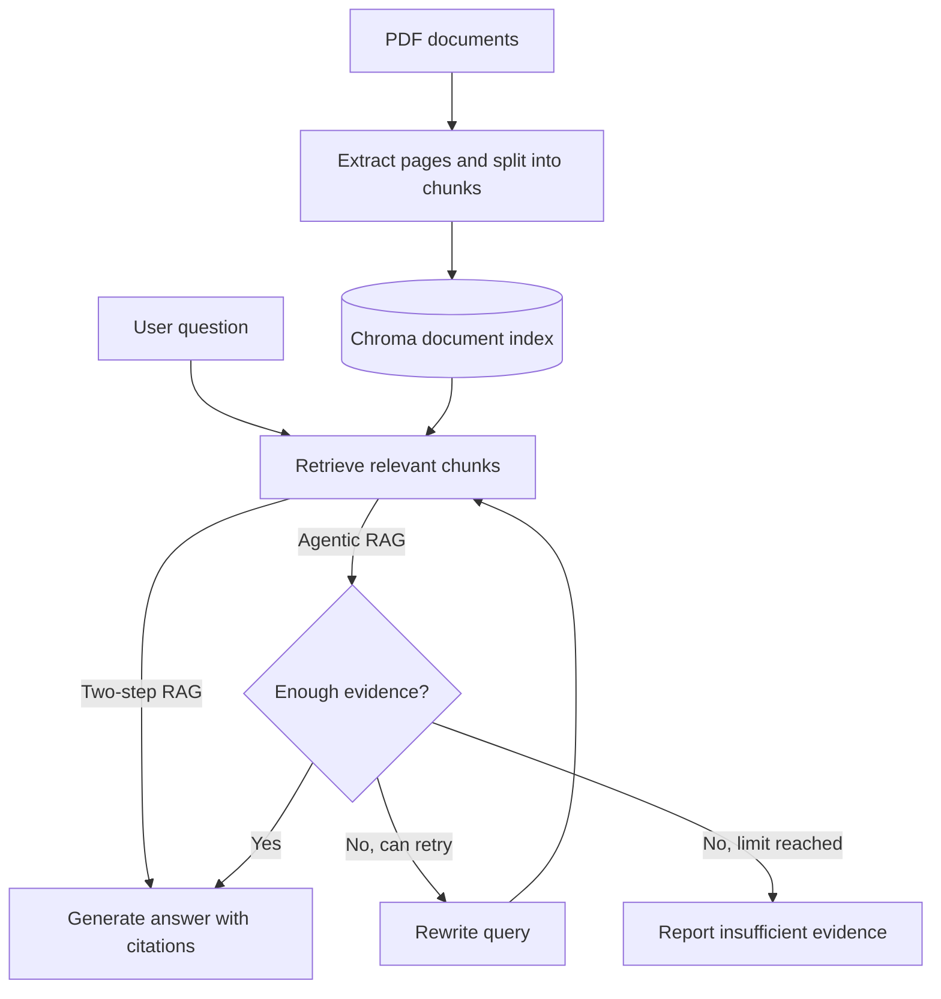

# ResearchOps Copilot

A retrieval-augmented generation (RAG) system for answering questions about scientific and technical PDF documents, with page-level citations.

It supports a standard two-step RAG pipeline and an optional LangGraph workflow that evaluates retrieved evidence, rewrites queries when needed, and avoids generating answers that are not supported by the documents.

## Features

- PDF ingestion with page metadata and overlapping text chunks
- Gemini embeddings and answer generation, with persistent Chroma storage
- Dense, BM25, and hybrid retrieval (reciprocal rank fusion)
- Answers with page-level citations and source-reference validation
- Optional LangGraph workflow with evidence evaluation, query rewriting, and a configurable retry limit
- Optional LangSmith tracing
- Automated tests and a fixed-question evaluation script

## Architecture



The index stores text chunks along with their source information and page numbers. Retrieval supports dense semantic search, BM25 keyword search, or a hybrid approach combining both. With **two-step RAG**, retrieved chunks are passed directly to answer generation. With **agentic RAG**, LangGraph first evaluates whether the retrieved evidence is sufficient. If not, it can rewrite the query and search again, up to a configured limit. If there is still not enough evidence, the system does not generate an unsupported answer. Citations are checked to confirm that they refer to retrieved sources.

## Project structure

```text
researchops-copilot/
├── data/
│   ├── documents/               # Place your PDFs here
│   └── vectorstore/             # Generated locally; not committed
├── evaluation/
│   ├── dataset.json
│   ├── results/
│   └── run_baseline.py
├── scripts/
│   ├── ask.py
│   ├── ask_agent.py
│   ├── build_index.py
│   ├── inspect_pdf.py
│   ├── search_index.py
│   └── smoke_test.py
├── src/
│   └── researchops_copilot/
│       ├── agentic_rag/
│       ├── evaluation/
│       ├── ingestion/
│       ├── rag/
│       ├── retrieval/
│       └── models.py
├── tests/
├── env-example.env
├── .gitignore
├── .python-version
├── pyproject.toml
├── uv.lock
└── README.md
```

## Setup

### 1. Clone the repository

```powershell
git clone https://github.com/Nir-Fried/researchops-copilot.git
cd researchops-copilot
```

### 2. Install dependencies

```powershell
uv sync
```

### 3. Configure environment variables

In PowerShell, copy the environment template to create a local `.env` file:

```powershell
Copy-Item env-example.env .env
```

Edit `.env` and enter your Google API key:

```dotenv
GOOGLE_API_KEY=your_google_api_key
```

LangSmith tracing is optional. To run without tracing, set this in `.env`:

```dotenv
LANGSMITH_TRACING=false
```

## Add documents

Place one or more text-based PDF files in `data/documents/`.

To check how PDF text is extracted and split into chunks before indexing:

```powershell
uv run python scripts\inspect_pdf.py data\documents\your-paper.pdf
```

## Build the index

```powershell
uv run python scripts\build_index.py --reset
```

The Chroma database is saved to `data/vectorstore/` and is excluded from Git. The `--reset` option clears the existing index before building a new one.

## Search without generation

```powershell
uv run python scripts\search_index.py "What is scaled dot-product attention?"
```

## Ask questions with two-step RAG

Choose between `dense`, `bm25`, and `hybrid` retrieval:

```powershell
uv run python scripts\ask.py "What is scaled dot-product attention?" --retriever dense
uv run python scripts\ask.py "What is scaled dot-product attention?" --retriever bm25
uv run python scripts\ask.py "What is scaled dot-product attention?" --retriever hybrid
```

To display the retrieved chunks:

```powershell
uv run python scripts\ask.py "Why are positional encodings necessary?" --retriever hybrid --show-context
```

## Ask questions with agentic RAG

```powershell
uv run python scripts\ask_agent.py "What is scaled dot-product attention?"
```

To display the final retrieved text chunks:

```powershell
uv run python scripts\ask_agent.py "What is scaled dot-product attention?" --show-context
```

To check how the agent handles a question that the documents do not answer:

```powershell
uv run python scripts\ask_agent.py "What is my favorite food?"
```

The agentic CLI reports the retrieval strategy, queries attempted, evidence evaluation, retry count, answer status, and cited pages and chunks. Use `--max-retries` to control the maximum number of query rewrites.

## Tests and evaluation

Run the automated tests:

```powershell
uv run pytest
```

Run the evaluation script for the **dense two-step RAG baseline**:

```powershell
uv run python evaluation\run_baseline.py
```

The script uses questions from `evaluation/dataset.json` and saves results to `evaluation/results/dense-rag-baseline.json` by default. Build an index from the relevant PDFs before running it. This evaluation covers **dense two-step RAG only**; it does not evaluate the agentic workflow or compare all three retrieval strategies.
