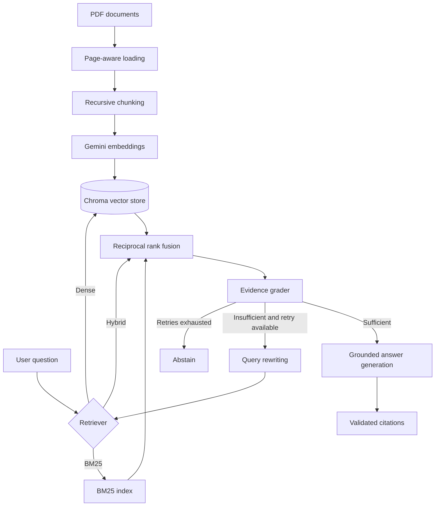

# ResearchOps Copilot

A citation-grounded retrieval-augmented generation (RAG) system for scientific and technical PDFs.

The project includes an agentic LangGraph workflow that grades retrieved evidence, rewrites weak queries, retries retrieval, and abstains when the indexed documents do not contain enough information.

## Features

- PDF ingestion with page-level metadata
- Recursive, overlapping text chunking
- Gemini embeddings and generation
- Persistent Chroma vector storage
- Dense semantic retrieval
- BM25 keyword retrieval
- Hybrid retrieval with reciprocal rank fusion
- Citation-grounded answers with validated page references
- Controlled abstention for unsupported questions
- Agentic LangGraph retrieval workflow
- Query rewriting and bounded retrieval retries
- LangSmith tracing
- Deterministic evaluation suite
- Unit tests for chunking, citations, retrieval fusion, routing, and evaluation

## Architecture



## Agentic workflow

The LangGraph pipeline follows this path:

```text
Retrieve
  -> Grade evidence
      -> Generate answer
      -> Rewrite query and retrieve again
      -> Abstain when evidence remains insufficient
```

The workflow has a configurable retry limit to prevent unbounded loops.


## Project structure

```text
researchops-copilot/
├── data/
│   ├── documents/
│   └── vectorstore/              # Generated locally; not committed
├── evaluation/
│   ├── dataset.json
│   ├── results/
│   └── run_baseline.py
├── scripts/
│   ├── ask.py
│   ├── ask_agent.py
│   ├── build_index.py
│   ├── inspect_pdf.py
│   ├── search_index.py
│   └── smoke_test.py
├── src/
│   └── researchops_copilot/
│       ├── agentic_rag/
│       ├── evaluation/
│       ├── ingestion/
│       ├── rag/
│       ├── retrieval/
│       └── models.py
├── tests/
├── .env.example
├── .gitignore
├── pyproject.toml
├── uv.lock
└── README.md
```

## Setup

### 1. Clone the repository

```powershell
git clone https://github.com/YOUR_USERNAME/researchops-copilot.git
cd researchops-copilot
```

### 2. Install dependencies

```powershell
uv sync
```

### 3. Configure environment variables

Copy and Fill in the values:

```dotenv
GOOGLE_API_KEY=your_google_api_key

LANGSMITH_TRACING=true
LANGSMITH_API_KEY=your_langsmith_api_key
LANGSMITH_ENDPOINT=https://eu.api.smith.langchain.com
LANGSMITH_PROJECT=researchops-copilot-dev
```

LangSmith is optional. To run without tracing, set:

```dotenv
LANGSMITH_TRACING=false
```

## Add documents

Place one or more text-based PDF files in:

```text
data/documents/
```

Scanned image-only PDFs require OCR and are not supported by the current ingestion pipeline.

Inspect extraction and chunking before indexing:

```powershell
uv run python scripts\inspect_pdf.py data\documents\your-paper.pdf
```

## Build the index

```powershell
uv run python scripts\build_index.py --reset
```

The generated Chroma database is stored in `data/vectorstore/` and is excluded from Git.

## Search without generation

```powershell
uv run python scripts\search_index.py "What is scaled dot-product attention?"
```

## Ask questions with two-step RAG

Dense retrieval:

```powershell
uv run python scripts\ask.py "What is scaled dot-product attention?" --retriever dense
```

BM25 retrieval:

```powershell
uv run python scripts\ask.py "What is scaled dot-product attention?" --retriever bm25
```

Hybrid retrieval:

```powershell
uv run python scripts\ask.py "What is scaled dot-product attention?" --retriever hybrid
```

Display the retrieved chunks:

```powershell
uv run python scripts\ask.py "Why are positional encodings necessary?" --retriever hybrid --show-context
```

## Ask questions with agentic RAG

```powershell
uv run python scripts\ask_agent.py "What is scaled dot-product attention?"
```

Display the final evidence:

```powershell
uv run python scripts\ask_agent.py "What is scaled dot-product attention?" --show-context
```

Test query rewriting and abstention:

```powershell
uv run python scripts\ask_agent.py "What was Ashish Vaswani's favorite food?"
```

The CLI reports:

- Whether the answer is grounded
- Which retrieval strategy was used
- How many retrieval attempts occurred
- Which queries were tried
- Why the final evidence was accepted or rejected
- Which pages and chunks were cited
