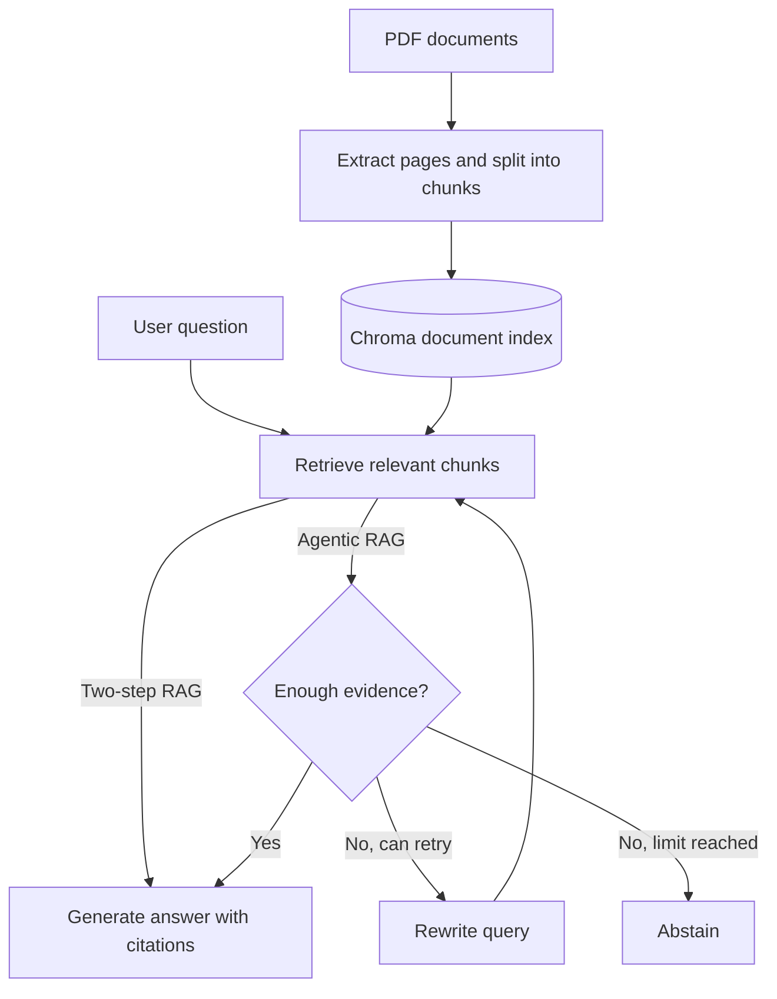

# ResearchOps Copilot

A retrieval-augmented generation (RAG) system for asking questions about scientific and technical PDFs, with page-level citations.

It supports both a standard two-step RAG pipeline and an optional LangGraph workflow that grades retrieved evidence, rewrites queries, retries retrieval, and abstains when evidence is insufficient.

## Features

- PDF ingestion with page metadata and overlapping text chunks
- Gemini embeddings and answer generation, with persistent Chroma storage
- Dense, BM25, and hybrid retrieval (reciprocal rank fusion)
- Answers with page-level citations and source-reference validation
- Optional agentic workflow with evidence grading, query rewriting, and bounded retries
- Optional LangSmith tracing
- Automated tests and a fixed-question evaluation script

## Architecture



The index stores document chunks and their metadata. Retrieval can use dense similarity, BM25 keyword matching, or a hybrid of both. In **two-step RAG**, the retrieved chunks go directly to answer generation. In **agentic RAG**, LangGraph first grades the evidence and can retry with a rewritten query before generating an answer or abstaining. Generated citations are checked against the retrieved sources.

## Project structure

```text
researchops-copilot/
├── data/
│   ├── documents/               # Place your PDFs here
│   └── vectorstore/             # Generated locally; not committed
├── evaluation/
│   ├── dataset.json
│   ├── results/
│   └── run_baseline.py
├── scripts/
│   ├── ask.py
│   ├── ask_agent.py
│   ├── build_index.py
│   ├── inspect_pdf.py
│   ├── search_index.py
│   └── smoke_test.py
├── src/
│   └── researchops_copilot/
│       ├── agentic_rag/
│       ├── evaluation/
│       ├── ingestion/
│       ├── rag/
│       ├── retrieval/
│       └── models.py
├── tests/
├── env-example.env
├── .gitignore
├── .python-version
├── pyproject.toml
├── uv.lock
└── README.md
```

## Setup

### 1. Clone the repository

```powershell
git clone https://github.com/Nir-Fried/researchops-copilot.git
cd researchops-copilot
```

### 2. Install dependencies

```powershell
uv sync
```

### 3. Configure environment variables

Create a local `.env` file from the provided template (PowerShell):

```powershell
Copy-Item env-example.env .env
```

Edit `.env` and enter your Google API key:

```dotenv
GOOGLE_API_KEY=your_google_api_key
```

LangSmith tracing is optional. To run without tracing, set this in `.env`:

```dotenv
LANGSMITH_TRACING=false
```

## Add documents

Place one or more text-based PDF files in `data/documents/`.

You can inspect PDF extraction and chunking before indexing:

```powershell
uv run python scripts\inspect_pdf.py data\documents\your-paper.pdf
```

## Build the index

```powershell
uv run python scripts\build_index.py --reset
```

The generated Chroma database is stored in `data/vectorstore/` and is excluded from Git. The `--reset` option clears the existing collection before rebuilding the index.

## Search without generation

```powershell
uv run python scripts\search_index.py "What is scaled dot-product attention?"
```

## Ask questions with two-step RAG

Choose between `dense`, `bm25`, and `hybrid` retrieval:

```powershell
uv run python scripts\ask.py "What is scaled dot-product attention?" --retriever dense
uv run python scripts\ask.py "What is scaled dot-product attention?" --retriever bm25
uv run python scripts\ask.py "What is scaled dot-product attention?" --retriever hybrid
```

To display the retrieved chunks:

```powershell
uv run python scripts\ask.py "Why are positional encodings necessary?" --retriever hybrid --show-context
```

## Ask questions with agentic RAG

```powershell
uv run python scripts\ask_agent.py "What is scaled dot-product attention?"
```

To display the final retrieved evidence:

```powershell
uv run python scripts\ask_agent.py "What is scaled dot-product attention?" --show-context
```

An example question for exploring query rewriting and abstention behavior:

```powershell
uv run python scripts\ask_agent.py "What is my favorite food?"
```

The agentic CLI reports the retrieval strategy, attempted queries, evidence grade, retry count, whether the question was answered, and cited pages and chunks. The number of rewrites can be controlled with `--max-retries`.

## Tests and evaluation

Run the automated tests:

```powershell
uv run pytest
```

Run the fixed-question evaluation for the **dense two-step RAG baseline**:

```powershell
uv run python evaluation\run_baseline.py
```

The evaluation uses `evaluation/dataset.json` and writes results to `evaluation/results/dense-rag-baseline.json` by default. Index the relevant source PDFs first. The baseline script does **not** evaluate the agentic workflow or compare all three retrieval strategies.
